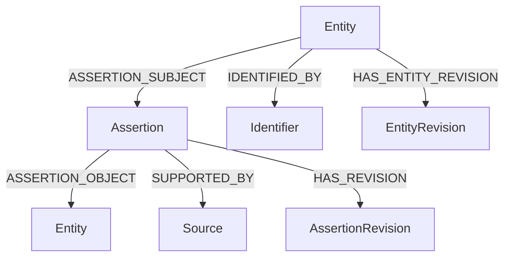

# Graph persistence

Neo4j Community **5.26.33 LTS**, pinned in `docker-compose.graph.yml`, uses the official Python driver **5.28.2**. The current LTS patch was checked against https://neo4j.com/deployment-center/ on 2026-11-22. The optional overlay preserves the existing Redis/API/worker composition. Redis remains authoritative for research, workspaces and permissions; Neo4j owns only graph entities, identifiers, assertions, revisions and source snapshots.

## Representation



Payloads preserve full validated contracts as canonical JSON; indexed scalar properties drive scoped lookup and temporal filters. No materialized financial edges are stored, so there is no second fact source to reconcile. Evidence locations remain in assertion payloads; SUPPORTED_BY links sources atomically. Composite uniqueness covers scoped entity/source/assertion IDs, identifiers, semantic assertion fingerprints and revision numbers. Community does not enforce property existence or endpoint semantics; the trusted repository enforces those inside transactions. Do not grant arbitrary database writers access.

GraphRepository has explicit typed entity upsert/get, authoritative ID resolve, immutable source save/get, immutable assertion save, lifecycle transition and bounded one-hop assertions_for operations. It owns one pooled async driver per API/worker process and short sessions per operation. No session is shared across requests. Read/write managed transactions retry retryable failures within the configured budget; callbacks perform database operations only. Database work has a transaction timeout and a bounded pool/acquisition timeout. Cancellation rolls back uncommitted work. Startup verifies connectivity and required constraints, but never creates schema. Enabled-but-unavailable graph startup fails clearly and closes resources; disabled startup never connects. Existing health/ready contracts remain unchanged.

## Configuration and Docker startup

Add the documented GRAPH_ENABLED/NEO4J_* settings to `python-backend/.env`; use your secret manager for real credentials. Default GRAPH_ENABLED=false preserves existing deployments. Community uses its standard `neo4j` database; changing NEO4J_DATABASE does not provision another database. Keep NEO4J_USERNAME=neo4j for Community bootstrap. No passwords are committed.

From repository root, with a populated `.env` (including production auth/model/provider settings as appropriate):

```bash
docker compose --env-file python-backend/.env -f docker-compose.research.yml -f docker-compose.graph.yml config --quiet
docker compose --env-file python-backend/.env -f docker-compose.research.yml -f docker-compose.graph.yml up -d --build
```

The graph overlay explicitly enables graph access for API, worker and migrator and uses the same interpolated credentials. `--env-file` is essential: Compose substitution does not read service env_file. Neo4j has a persistent volume, restart policy, loopback HTTP health probe, 512 MiB max heap and 256 MiB page cache. No host database ports are published. The migrator verifies actual Bolt connectivity after HTTP readiness; API/worker wait for successful migration completion. For local browser no-auth mode, append `-f docker-compose.local.yml` using the existing loopback-only rules. No graph fixture or financial facts are loaded automatically.

For a manual server, use `bolt://127.0.0.1:7687`, provision credentials, enable graph and run migrations before launching the existing API/worker. URI credentials are forbidden; use separate password configuration. Remote connections should use supported TLS schemes (`neo4j+s`, `bolt+s`) with trusted certificates and private networking.

## Read-only diagnostic API

- `GET /api/v1/graph/ontology`
- `GET /api/v1/graph/entities/{uuid}`
- `GET /api/v1/graph/entities/{uuid}/assertions?limit=50&known_at=<aware timestamp>&valid_at=<aware timestamp>`

Existing platform authentication/rate limits apply. Optional `workspace_id` requires current membership on every data request; omitted means the authenticated principal's private graph. Data scope cannot be supplied as a raw key. Results include proposed/disputed facts with explicit statuses: consumers must not treat every result as verified. Limit is 1..100, ordering deterministic, traversal exactly one hop. There are no mutation, verification, ingestion, free-form Cypher or LLM graph tools exposed. Trusted backend code uses GraphRepository after authorization.

## Recovery and limits

The persistent /data volume includes stores and transaction logs. For Community backups, stop graph writers and Neo4j, take an offline `neo4j-admin database dump neo4j`, retain configuration/migration source and encrypted credentials separately, and test a restore into a separate volume using a compatible pinned version. Do not copy a live store or use `docker compose down -v` during upgrades. Restarting containers retains committed graph data. Redis backup/restore remains a separate required operation; coordinate workspace retention with private graph retention before production ingestion.

Current limits: no automatic ingestion/extraction, fuzzy resolution, general graph reasoning, graph display, simulations or trading; no verified-source workflow UI; metadata entity history is stored but not exposed as a historical entity API; one-hop queries have bounded results and timeouts rather than deep traversal or offset pagination. Production volume sizing, TLS, backup schedules, retention and deployment smoke tests remain operator responsibilities.

Graph transaction counts and duration histograms are available through the existing authenticated `/metrics` endpoint as `financialagentia_graph_operations_total` and `financialagentia_graph_transaction_seconds`. Labels are limited to mode/outcome; no tenant IDs, credentials, URLs or passage content are emitted.
