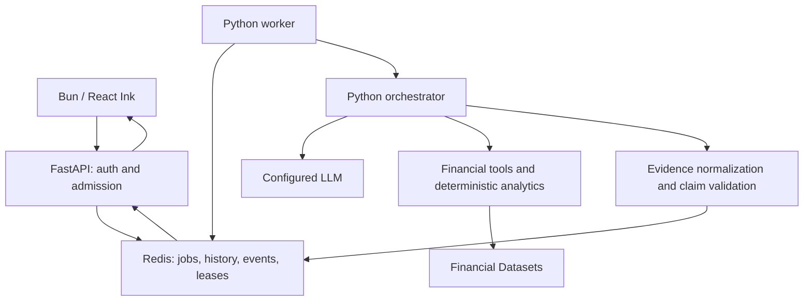

# FinancialAgentia execution and operations

## Supported architecture



Redis is the existing database; no SQL tables or second queue were introduced.
Submission is validated before an atomic QUEUED admission. Execution state names
remain compatible: QUEUED → RUNNING → SUCCEEDED, FAILED, CANCELLED or TIMED_OUT.
RUNNING publishes understand, plan, execute, reflect, answer and validate phases.
CANCEL_REQUESTED must settle before a terminal success can commit. These are the
existing API names; they are not the proposed REQUESTED/VALIDATING/SYNTHESIZING
state vocabulary. The report separately states COMPLETE, PARTIAL or
INSUFFICIENT_EVIDENCE. Insufficient evidence fails the job with a persisted report.

## Configuration and startup

Use `.env.example` here for the API and worker and `env.example` at repository
root for the client. Production needs BACKEND_ENV=production, SECURE_COOKIES=true,
REDIS_URL and either JWT_SECRET or BACKEND_API_KEY. Set JWT_ISSUER/JWT_AUDIENCE
when your identity provider uses them. Production JWTs require an expiry. A shared
API key is one shared account, not separate tenants. JWT subjects isolate users.
Keep all financial-provider and model credentials on the server.

Run the commands in README.md. The Docker Compose reference starts Redis, API
and a separate worker. `docker compose -f docker-compose.research.yml config`
validates configuration when Docker is available. TLS termination, Redis ACL/TLS,
backup retention, monitoring and the identity-token issuer remain operator work.
The repository does not implement a web signup/login frontend.

## Limits and costs

- Ten new admissions per principal per fixed 60-second window, five active jobs
  per principal by default, and 1000 globally active jobs. Existing idempotent
  requests bypass new-admission quotas. RESEARCH_MAX_ACTIVE_PER_USER adjusts the
  active limit from 1 through 100.
- At most three worker claims per job; a crashed owner's lease expires before
  recovery, and generation fencing prevents stale writes. External calls can
  happen more than once after a crash. This is not exactly-once provider billing.
- One job per worker, five task slots per job, ten tasks and five calls/task per
  plan, and AGENT_MAX_ITERATIONS plans (default three). Tool and HTTP retries are
  bounded; transient retries back off with jitter. Execution deadline defaults to
  300 seconds, maximum 3600. The client waits six minutes, then `/resume` can
  recover an active job. No disconnect-driven cancellation.
- LLM calls explicitly pass output-token limits (default 4096) to supported SDKs.
  Aggregate spend/usage accounting is not complete; no dollar cost is fabricated.
- Provider cache TTL: snapshots 10s, news 30s, other data 120s; 128 entries per
  process. Cached responses retain their retrieval time and are labelled cached.
  Concurrent identical requests coalesce within a provider process. Cross-worker
  duplicate-fetch suppression is not guaranteed.
- Evidence: 200 metric records, 50 collected task outputs, 300KB per collected
  task, 1MB intermediate checkpoints. Client responses are bounded to 512KB.
  Agent summaries avoid copying raw provider output into final reports.

## Financial accuracy boundary

The registered tools use Financial Datasets; absent credentials never enable a
mock provider. CI injects external HTTP and model fixtures explicitly. The
provider adapter checks symbols (including nested statements), finite positive
closes, duplicate timestamps, ranges, currencies, and future dates. Missing
exchange, currency, timezone or adjustment metadata stays unknown. A price
snapshot is not automatically labelled live. Provider pagination is disclosed
as incomplete; the service does not follow arbitrary next-page URLs.

Calculations use simple fractional returns, compounded returns, CAGR based on
actual elapsed days/365.25, sample volatility annualized at 252 observations,
maximum drawdown as a negative fraction, and annualized Sharpe with a zero
risk-free default. Constant-return Sharpe and zero-denominator ratios are
undefined, not infinity. SMA/simple-window RSI, margins, period-end ROE,
correlation and benchmark-relative returns are deterministic. Missing prices
are rejected; there is no imputation. Prices do not imply dividend reinvestment
or corporate-action adjustment unless the provider supplies that policy.

Derived evidence retains original input IDs and the calculation method.
A numerical match does not verify surrounding AI prose: displayed financial
claims are rendered from evidence fields. News is displayed as dated,
source-attributed publisher headlines, not established events, sentiment facts,
or numerical financial analysis. News deduplication uses the canonical URL.
Advanced free-form synthesis, full risk scenarios, source contradictions and
point-in-time filing publication availability are not fully implemented.
Historical backtesting is not a supported verified feature.

Provider reference schemas reviewed for this change:
https://docs.financialdatasets.ai/api/prices/snapshot
https://docs.financialdatasets.ai/api/prices/historical
https://docs.financialdatasets.ai/api/financials/all-financial-statements
https://docs.financialdatasets.ai/api/news/company

## Persistence, upgrade and recovery

The existing Redis hashes/streams remain compatible. New jobs add schema version,
claim limit, artifact checkpoints and an owner-sorted history index. Existing jobs
remain readable by ID. Before rollout, back up Redis, then from this directory:

```sh
PYTHONPATH=. python scripts/migrate_execution_index.py         # dry run
PYTHONPATH=. python scripts/migrate_execution_index.py --apply # additive and repeatable
```

The index upgrade preserves job fields and TTLs. Rollback may remove only the
added `jobs:<principal>` indexes and deploy prior code; preserve exec hashes,
events, queue, idempotency keys and session locks. Do not restore an old database
snapshot while any worker is running. Recovery/fencing tests use real Redis.
No production data migration was executed during development.

Jobs/events/results normally expire 24 hours after terminal completion; admission
idempotency lasts 24 hours from submission, and conversation context holds the
last 20 turns. This is an explicit short retention window, not a permanent archive.
Use separate export/archive work before requiring long-term financial history.
AOF everysec in the reference Compose stack can lose roughly one second on a
crash; stronger persistence, backups and restore drills must match your SLA.

## Streaming, readiness and shutdown

SSE events use Redis stream IDs, persisted replay via Last-Event-ID, idle comment
heartbeats, no-cache/no-transform and X-Accel-Buffering=no. Subscribers read bounded
batches; a terminal snapshot is delivered even when an old stream is trimmed.
The terminal CLI uses authenticated polling and authoritative status instead.
No synthetic percentage is displayed. Stream disconnects do not own job lifetime.

Worker process heartbeats expire after 30 seconds. Job leases last 20 seconds and
renew approximately every second. SIGTERM stops admission of new worker jobs,
allows a five-second completion window, then releases local tasks without turning
a shutdown into a user cancellation. Another worker can recover after expiry.
`/ready` returns 503 on Redis outages or absent worker heartbeat; `/health` remains
an independent process probe. Structured worker logs include execution, worker,
generation, outcome and error category; LLM parse logs exclude raw content.

## Reproducible validation

```sh
# From repository root
bun install --frozen-lockfile
bun run typecheck
bun test
bun run build
# From python-backend, with a disposable real Redis database and Bun on PATH
python -m pip install -r requirements-dev.txt
ruff check .
python -m compileall -q app dexter_py tests scripts
PYTHONPATH=. python scripts/export_contracts.py --check
TEST_REDIS_URL=redis://127.0.0.1:6379/15 python -m pytest -q
# Live access is separate and explicitly opt-in:
FINANCIAL_RESEARCH_LIVE_TESTS=true python -m pytest -q tests/test_live_provider.py
```

Never mark skipped live-provider tests as passed. The socket-level E2E test starts
real Uvicorn, executes the real worker/orchestrator/provider adapter against
fixtures, runs the Bun transport, reconnects, fetches history, validates the wire
report and renders AnswerBox through Ink. It does not validate paid API access or
an installed production reverse proxy. See the engineering report for actual
commands/results and remaining release gates.
